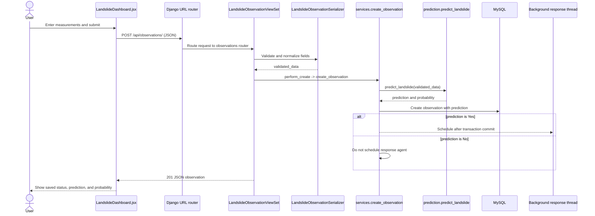

# Application Workflow

This guide follows the current implementation from form submission through
database persistence and the response shown in the browser.

## Observation submission flow



## Step-by-step: new observation

1. **Enter values.** `App` in `frontend/src/App.jsx` renders
   `LandslideDashboard`. Its observation form is in
   `frontend/src/components/LandslideDashboard.jsx`. `handleChange` updates
   React form state.
2. **Submit.** `handleSubmit` prevents a regular browser form submission,
   avoids duplicate in-flight submissions, converts numeric fields, and sends
   JSON to `POST /api/observations/`. The React code sends dataset-style keys:
   `Location_ID`, `Max_Temp_C`, `Humidity_Pct`, `Wind_Speed_kmh`,
   `Rainfall_mm`, `Slope_Angle_Deg`, and `Vegetation_Cover`.
3. **Route request.** `app/config/urls.py` includes
   `observations.urls` under `/api/`. `app/observations/urls.py` registers
   `LandslideObservationViewSet` on `observations/`.
4. **Validate and translate.** `LandslideObservationViewSet` uses
   `LandslideObservationSerializer` from `serializers.py`. Its
   `to_internal_value` converts dataset column keys to model field keys. The
   serializer rejects sending both spellings for the same value and marks
   prediction, ID, and timestamp fields as read-only.
5. **Create service call.** The view's `perform_create` passes validated data
   to `services.create_observation`.
6. **Predict.** `create_observation` calls
   `prediction.predict_landslide`. That function loads the joblib model, creates
   the model input row, optionally one-hot encodes vegetation for the supported
   alternative model feature schema, then calls `predict` and `predict_proba`.
7. **Persist.** `create_observation` calls
   `LandslideObservation.objects.create(**validated_data, **prediction)`.
   Django writes the observation and model outputs to MySQL.
8. **Conditional follow-up.** If the saved prediction equals `"Yes"`,
   `_schedule_response_agent` registers a callback with `transaction.on_commit`.
   Once committed, `_start_response_agent` starts a daemon thread that calls
   `_run_response_agent`; that calls
   `run_landslide_response_agent(observation_id)`.
9. **Return API response.** DRF serializes the created record and returns HTTP
   `201 Created`. The asynchronous agent is not awaited.
10. **Render result.** React's `handleSubmit` stores the returned record in
    `predictionResult`, shows a saved message, clears the form, and updates the
    in-memory record list. The result panel displays the prediction and
    probability as a percentage.

## Prediction outcomes

### If prediction is `No`

- The observation, `"No"` prediction, and probability are stored.
- The service does not schedule the response-agent thread.
- The saved observation response is returned to React.
- React displays the result and probability; there is no automatic contact
  lookup or email for this result.

### If prediction is `Yes`

- The observation and prediction are stored first.
- The request response can return before the follow-up starts or finishes.
- After commit, the worker loads the saved observation.
- `retrieve_safety_measures` calls the RAG helper using a fixed landslide safety
  query. The answer must have source references to be treated as verified.
- `get_emergency_contact` selects the first `EmergencyAuthority` ordered by
  authority name and ID. It does not filter by location, active status, or
  verification status.
- If no contact exists, email is skipped.
- If sourced safety guidance is unavailable, the workflow reports that human
  review is needed and skips email.
- Otherwise, `create_response_agent` creates a CrewAI agent and
  `run_landslide_response_agent` executes a single sequential summary task.
- `send_emergency_email` validates the recipient and uses Django `send_mail`.
- `_run_response_agent` prints the resulting workflow JSON; errors are logged.
- React still only receives the observation response. It does not receive the
  later agent summary or delivery status.

## Positive-prediction function call order

```text
services.create_observation
  -> prediction.predict_landslide
  -> LandslideObservation.objects.create
  -> _schedule_response_agent
  -> transaction.on_commit
  -> _start_response_agent
  -> _run_response_agent
  -> response_agent.run_landslide_response_agent
       -> retrieve_safety_measures
            -> rag.ask_rag
                 -> retrieve_documents
                 -> generate_answer
       -> get_emergency_contact
       -> create_response_agent
            -> Crew.kickoff (summary only)
       -> send_emergency_email
            -> Django send_mail
```

On updates, `views.LandslideObservationViewSet.perform_update` calls
`services.update_observation`, which merges changed fields with current model
input, predicts again, updates and saves the instance, and schedules the same
follow-up if the resulting prediction is `Yes`.

## Separate safety-assistant interaction

The user can also choose the Safety assistant in React. This is separate from
the automatic background follow-up:

1. `askSafetyAssistant` in `LandslideDashboard.jsx` POSTs
   `{"question": "..."}` to `/api/safety-assistant/`.
2. `SafetyAssistantView.post` validates the question with
   `SafetyQuestionSerializer`.
3. The view calls `services.answer_safety_question`.
4. That calls `rag.ask_rag`, which retrieves top passages from Pinecone and
   generates an answer using Ollama.
5. Django returns `{"answer": ..., "sources": [...]}`.
6. React displays the answer and source page/text entries.

For this user-initiated endpoint, the question must be at least 3 and at most
1000 characters. RAG configuration or service failures are returned as
service-unavailable errors rather than fabricated answers.

## API failure paths

- Serializer validation failures return DRF validation errors; React displays
  a submission error.
- If the prediction model cannot be loaded or its feature schema is
  unsupported, the view maps `ImproperlyConfigured` to HTTP 503 with code
  `prediction_model_unavailable`. The create path fails before saving.
- Safety-assistant configuration/runtime failures are mapped to HTTP 503 by
  `SafetyAssistantView`.
- The asynchronous response-agent errors are logged, and do not roll back the
  saved observation.

The system is a learning prototype, not an official emergency warning service.
