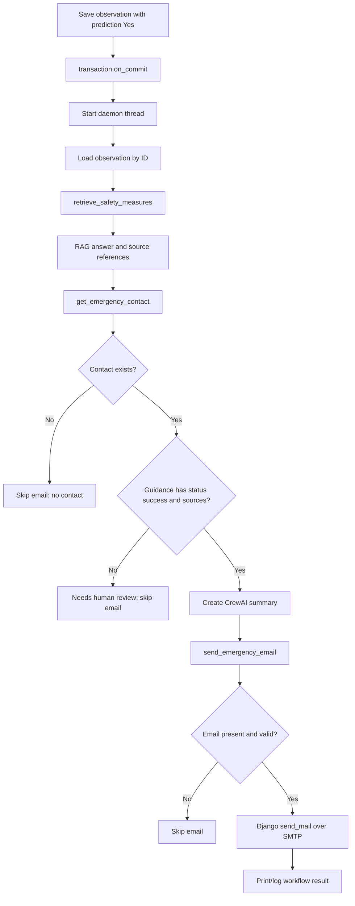

# Email Notification Workflow

Email is a backend follow-up for observations whose saved model prediction is
`"Yes"`. It runs asynchronously and is not part of the synchronous React API
response.

## Trigger and execution order



Function call order is controlled by `run_landslide_response_agent` in
`app/observations/response_agent.py`:

1. `services._schedule_response_agent` registers after-commit execution.
2. `_start_response_agent` creates the daemon worker.
3. `_run_response_agent` calls `run_landslide_response_agent`.
4. `retrieve_safety_measures` calls `rag.ask_rag` with the configured fixed
   landslide safety query.
5. `get_emergency_contact` looks up the first authority.
6. If guidance and contact checks pass, `create_response_agent` creates a
   CrewAI summarizer and the crew runs its sequential task.
7. `send_emergency_email` validates the selected email address and calls
   Django's `send_mail`.
8. `_run_response_agent` prints the resulting workflow object; failures are
   logged.

When prediction is `"No"`, the service does not schedule this process.

## Emergency contact selection

`get_emergency_contact()` in `response_agent.py` queries
`EmergencyAuthority.objects.order_by("authority_name", "id").first()`.
Important behavior:

- It always selects the first row in that ordering.
- It does not match the observation's `location_id`.
- It does not filter inactive or unverified records.
- It does not use the contact phone number for SMS.
- If the table is empty, the workflow returns `contact_not_found` and does not
  send email.

The model is registered in Django Admin using `EmergencyAuthorityAdmin`. The
demo fixture has an `.invalid` address and is not a real recipient. Verify
authority details through trusted official sources before adding real data.

## Email configuration

`app/config/settings.py` configures Django's email backend:

- Backend: `django.core.mail.backends.smtp.EmailBackend`
- Host: `smtp.gmail.com`
- Port: `587`
- TLS: enabled
- SSL: disabled
- Sender and credentials: `EMAIL_HOST_USER`, `EMAIL_HOST_PASSWORD`
- `DEFAULT_FROM_EMAIL`: set from `EMAIL_HOST_USER`
- Timeout: 20 seconds

Set `EMAIL_HOST_USER` and `EMAIL_HOST_PASSWORD` as private environment values
or in the ignored project-root `.env`. Never put credentials in source code,
documentation examples, logs, or commits. If using a provider that requires a
special application password, follow that provider's account security setup.
The current host/port/TLS values are fixed in settings; other SMTP providers
would require an intentional settings change.

## Email body and subject

`send_emergency_email` creates a subject similar to:

```text
Wayanad Landslide POC - Observation <id> Response Details
```

The plain-text message greets the selected authority, labels the content as
landslide safety guidance, includes the RAG answer, advises following the
guidance and contacting authorized disaster-management authorities, and signs
as the Wayanad Landslide Early Warning and Response System.

Illustrative format (actual guidance comes from RAG):

```text
Dear <authority name>,

LANDSLIDE SAFETY GUIDANCE - WAYANAD

The following safety guidance has been retrieved from the landslide safety
knowledge base.

SAFETY GUIDANCE

<source-backed guidance text>

Please read and follow the above safety guidance carefully. For further
assistance, contact the appropriate authorized disaster management authorities.

Regards,
Wayanad Landslide Early Warning and Response System
```

## Skip and error handling

`send_emergency_email` first checks for a blank address and validates a
non-blank one with Django's `validate_email`.

| Condition | Workflow result |
| --- | --- |
| No authority row | `contact_not_found`; email skipped. |
| Guidance missing or sources absent | `needs_human_review`; email skipped. |
| Blank email | Email status `skipped`. |
| Invalid email | Email status `skipped`. |
| Backend returns exactly one sent message | Email status `success`. |
| Backend returns a count other than one | Email status `failed`. |
| SMTP/backend exception | Email status `failed`; exception is logged. |
| CrewAI summary fails | Error is logged; workflow uses a fallback summary and continues to email checks. |
| Background workflow fails unexpectedly | Error is logged; the observation remains saved. |

The result is printed to the Django process output, not stored in a current
alert table and not returned to the React client.

## Dry-run mode

There is **no application-level dry-run switch** in the current settings or
email function. The configured backend is SMTP. Tests use mocks/patches to
verify behavior without delivering actual messages. Do not test by entering a
real recipient unless you intend to send an email. A safe production-quality
dry-run or approval workflow would need to be implemented separately.

The workflow is a prototype and must not be treated as an official emergency
notification service.
