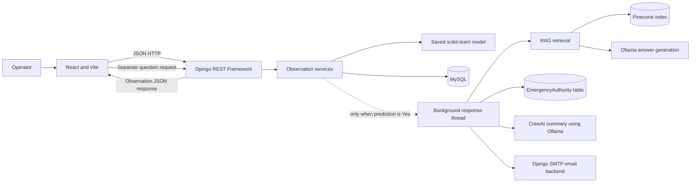

# Project Overview

## Introduction

The Wayanad Landslide Early Warning and Response System is a learning prototype
for entering environmental observations, estimating landslide likelihood with
a saved machine-learning model, and retrieving safety-guide passages. The
implemented application has a React web interface and a Django REST Framework
(DRF) API.

The implementation currently supports observation create/read/update/delete,
an observation prediction and probability, a user-operated document-based
safety assistant, and an asynchronous backend follow-up when a prediction is
`Yes`. That follow-up can retrieve sourced safety guidance, look up an
emergency-authority record, summarize the result with CrewAI, and attempt an
email.

> **Prototype limitation:** This is not an officially validated warning or
> dispatch system. Predictions are estimates, contact selection is not
> location-specific, and the background response result is not shown in the
> web application.

## Objectives

- Collect site readings through a straightforward form.
- Save readings and model-generated results in a relational database.
- Make stored observations reviewable and editable.
- Demonstrate a separate retrieval-augmented safety-guide assistant.
- Demonstrate a server-side response workflow for positive predictions.
- Keep the model result separate from the human-facing safety guidance.

## Current features

| Feature | Current implementation |
| --- | --- |
| New observation form | React component `LandslideDashboard` in `frontend/src/components/LandslideDashboard.jsx`. |
| Observation API | DRF `LandslideObservationViewSet`, routed at `/api/observations/`. |
| Validation | `LandslideObservationSerializer` and validators on `LandslideObservation`. |
| Prediction | `predict_landslide` loads `notebooks/landslide_logistic_pipeline.joblib`. |
| Persistence | `LandslideObservation` is stored in the configured MySQL database. |
| Record list and actions | React lists all observations newest first, with edit and delete controls. |
| Safety assistant | `POST /api/safety-assistant/` retrieves document excerpts and generates a response. |
| Positive-result follow-up | A background thread runs the Python-controlled response workflow after database commit. |
| Emergency contact administration | `EmergencyAuthority` can be managed through Django Admin. |
| Email | The positive-result workflow can send a source-backed guidance email using Django SMTP settings. |

## What is not currently implemented

- There is no Power BI connection, dashboard, report, or data-export integration
  in the application source. Power BI is mentioned as a future idea in the
  repository README.
- The React **All Records** view is a table, not a charts/analytics dashboard.
- There is no automated sensor ingestion or CSV upload interface.
- There is no dedicated location entity or contact-to-observation foreign key.
- No alert approval workflow, alert audit tables, SMS integration, or public
  warning endpoint exists in the current `models.py` and API.
- The response-agent output is logged by the Django process; React does not
  poll or display its email status or CrewAI summary.
- The response-agent selects the first authority ordered by name and ID. It
  does not select by observation location or filter by active/verified status.
- Email has no application-level dry-run setting. Tests mock email operations.

## Technology stack

### Backend

- Python
- Django and Django REST Framework
- MySQL configured as Django's default database
- `mysqlclient` database driver
- scikit-learn/joblib and pandas for model inference
- Sentence Transformers for query embeddings
- Pinecone for vector search
- Ollama for RAG answer generation and the CrewAI summary agent
- CrewAI for the response summary task
- Django's SMTP email backend

Exact Python dependency pins are listed in the repository-root
`requirements.txt`.

### Frontend

- React 19
- Vite
- JavaScript and CSS
- `fetch` for HTTP requests
- Oxlint for linting

Exact npm scripts and package versions are in `frontend/package.json`.

## High-level architecture



The notebook `notebooks/landslide_rag_index.ipynb` prepares the Pinecone
vectors. Runtime code in `app/observations/rag.py` retrieves vectors but does
not index the PDF. There is no Power BI data connection in this architecture.

## Main source directories

```text
app/
  config/          Django settings and project URL routing
  observations/    API, models, prediction, RAG, and response workflow
frontend/
  src/             React entry point and dashboard component
data/              CSV datasets used by model-development notebooks
notebooks/         Model training, RAG indexing, PDF, and model artifact
models/             Currently contains only a placeholder .gitkeep file
documentation/      This documentation set
```

See [System Architecture](./System_Architecture.md) and
[Application Workflow](./Application_Workflow.md) for detailed diagrams.
