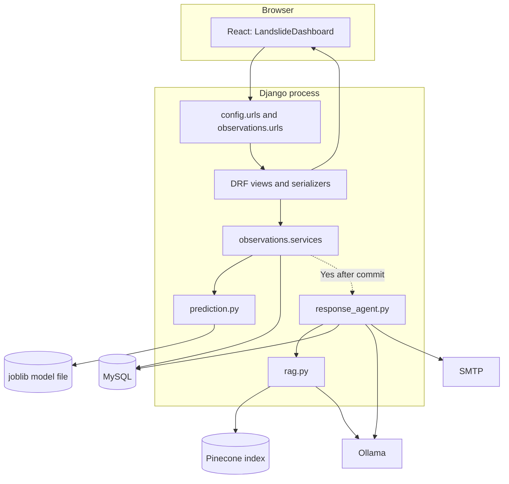

# System Architecture

## Architecture summary

The implemented system has a React/Vite client, a Django REST Framework API, a
MySQL database, an on-disk scikit-learn model, Pinecone-based document
retrieval, Ollama text generation, and a Django SMTP email backend. Prediction
is part of the synchronous observation request. The additional response
workflow runs in a daemon thread after the transaction commits.

## React frontend

- `frontend/src/main.jsx` mounts the React application into the HTML root.
- `frontend/src/App.jsx` renders the `LandslideDashboard` component.
- `frontend/src/components/LandslideDashboard.jsx` contains the form, saved
  records view, safety assistant view, API calls, and response state.
- `App.css`, `index.css`, and component CSS provide styling.
- `frontend/vite.config.js` configures the React plugin.

The component's three views are selected with local state (`new`, `records`,
and `safety`); they are not separately routed pages. The records view is a
table, not a Power BI analytics dashboard.

## Django backend

`app/manage.py` starts Django. `app/config/settings.py` configures installed
apps, middleware, MySQL, email, and CORS. `app/config/urls.py` mounts the
observations URL configuration under `/api/`.

The `observations` app separates responsibilities:

- `urls.py`: endpoint paths and DRF router registration.
- `views.py`: request handlers and HTTP error mapping.
- `serializers.py`: request/response field definitions and validation.
- `services.py`: prediction, database create/update, and follow-up scheduling.
- `models.py`: persistent observation and authority records.
- `prediction.py`: model loading and inference.
- `rag.py`: runtime embedding, vector search, and answer generation.
- `response_agent.py`: positive-prediction guidance/contact/summary/email flow.

## Database architecture

Current application models are only `LandslideObservation` and
`EmergencyAuthority`. They have no foreign-key relationship. `location_id` on
each is an integer; it is not a relation to a `Location` model. The response
agent currently does not use it to filter contacts.

`LandslideObservation` uses Django's default table name
`observations_landslideobservation`. `EmergencyAuthority` explicitly uses the
table name `EmergencyAuthority`.

Migrations `0003` and `0005` show an intermediate alert/audit schema that was
later removed. Those removed models are not current Django models or active
workflow persistence.

## AI/ML prediction architecture

`app/observations/prediction.py` loads
`notebooks/landslide_logistic_pipeline.joblib` with joblib. The artifact is
loaded once per Python process using `lru_cache`. The single input row contains
temperature, humidity, wind speed, rainfall, slope, and vegetation cover.
Location ID and historical observed outcome are not model features.

The function returns a binary class string and probability for class `1`; it
does not calculate an explicit low/medium/high risk category or enforce an
alert threshold beyond the classifier's class prediction.

## RAG architecture

The offline preparation notebook `notebooks/landslide_rag_index.ipynb` extracts
pages from `notebooks/Landslide_safety.pdf`, splits page text into overlapping
word chunks, embeds them with `intfloat/e5-base-v2`, and upserts vectors and
page/text metadata to Pinecone.

At runtime, `app/observations/rag.py`:

1. Checks the Pinecone API key, index, dimension, and namespace contents.
2. Loads/caches the E5 embedding model.
3. Encodes the question with the `query:` prefix.
4. Retrieves up to three passages from Pinecone.
5. Sends only those excerpts plus the question to Ollama.
6. Returns answer text and source page/passages.

The runtime does not re-read or index the PDF. See
[AI/ML Documentation](./AI_ML_Documentation.md).

## CrewAI response-agent architecture

When an observation's prediction is `Yes`, `services.create_observation` (or
`update_observation`) schedules `_start_response_agent` with
`transaction.on_commit`. A daemon thread calls `run_landslide_response_agent`.

The Python function controls the workflow: get RAG guidance, retrieve an
authority row, check that guidance has sources, create a CrewAI agent/task to
summarize the known results, and send an email if eligibility checks pass.
CrewAI is used for the summary, not as the authority that selects or executes
these Python steps. Workflow results are printed/logged in the backend process,
not stored in an alert table and not returned to React.

## Power BI analytics integration

**Not implemented.** The root README describes Power BI dashboards as future
work. The source contains no Power BI connector, report, export endpoint, or
dashboard. A real integration would need to be designed and implemented; this
documentation does not assume a data source or deployment arrangement.

## Boundary and safety notes

- Model inference and observation save occur before the POST/PUT response.
- Positive-result follow-up is asynchronous and may fail after the observation
  has already been saved and returned.
- Email status and CrewAI summary are not visible through an API endpoint.
- There is no durable task queue; a process restart may interrupt a daemon
  thread.
- This prototype is not an official warning system.
